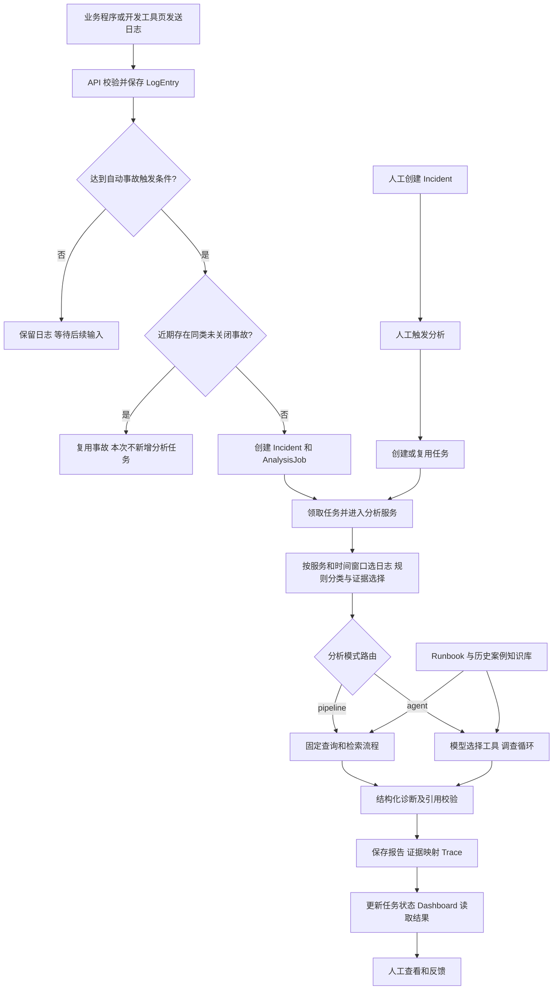

# 项目流程导读：从一条日志到一份诊断报告

核对日期：2026-09-19。依据当前源码（HEAD `f054237`），解释实际实现，不提出新架构。本文用于学习；工作计划与问题状态仍以 [项目基线](PROJECT_BASELINE.md) 为准。

## 1. 先知道系统究竟在做什么

它是一个帮助工程师排查故障的 Copilot：把分散日志、排障手册和历史案例组织起来，输出可回查材料的根因假设与建议。

系统的交付物是一份诊断报告。当前不会执行建议里的修复命令，也不会自动证明根因已经成立。

先把项目分成三条线：

| 线 | 解决的问题 | 入口 |
|---|---|---|
| 在线业务线 | 收到日志以后，如何形成并展示报告 | API → 事故 → 任务 → 分析 → 数据库 → Dashboard |
| 知识准备线 | 到哪里找排障经验，如何检索 | Runbook 文件、历史案例 JSON、分块和可选向量索引 |
| 离线验证线 | 如何判断代码和分析效果有没有变好 | tests、eval、Judge、消融实验 |

三条线有关联，但不是每次在线分析都会重新训练模型、跑评测或调用 Judge。



图中省略失败分支：执行异常可将任务标记失败；取证前置条件未满足或真实诊断材料全空，可形成证据不足结果；模型故障还可能降级到 Mock。任务执行成功不等于根因被证实。

## 2. 先分清数据对象

| 对象 | 含义 | 一个例子 |
|---|---|---|
| Service | 被观察的业务服务 | checkout-api |
| LogEntry | 一条原始日志 | 某时刻数据库连接超时 |
| Incident | 一次需要排查的事件 | checkout-api 本次错误爆发 |
| AnalysisJob | 执行一次分析的任务 | 排队、运行、成功或失败 |
| AnalysisRun | 一次分析产生的持久化报告 | 根因假设、参考资料、建议 |
| IncidentEvidence | 报告与证据日志之间的关联 | 本报告引用日志 ID 21 |
| AnalysisTrace | 分析过程的步骤记录 | 使用什么查询、检索后端、模型或降级 |
| DiagnosisFeedback | 人工对某份报告的评价 | 是否正确、评分与补充意见 |

一个服务有很多日志和事故。同一个事故可以先后分析多次，所以它可以有多个任务和多个报告；当前每个事故最多一个 pending/running 活动任务。

不要把“任务完成”“报告生成”“事故解决”当成同一件事。系统完成报告后，并没有自动修复业务故障。

## 3. 启动时发生什么

入口：[app/main.py](../app/main.py)。

1. 先执行 `prepare_config()` 加载并校验配置，再导入会读取配置的数据库等模块。
2. 建立数据库连接，建表并补充已有库的必要字段和索引。
3. 创建 FastAPI 应用，挂载请求大小限制、写入限流、页面与数据路由。
4. 进入服务生命周期时处理遗留任务：pending 重新派发，running 标记为中断失败。

这是服务启动过程，不是每收到一条日志都执行一次。向量索引由相关检索器按需初始化，也可以通过现有构建脚本提前准备，并不是启动时自动训练大模型。

## 4. 日志从哪里来，进入哪里

入口：[app/api/routes.py](../app/api/routes.py)、[integrations/python_logging_handler.py](../integrations/python_logging_handler.py)。

日志可以来自演示业务、其他接入程序或开发工具页。

- `POST /logs`：用已经存在的 service_id 上报。
- `POST /ingest/logs`：用 service_name 上报，服务不存在时自动注册。
- Python logging handler：先解析或注册服务，拿到 ID，再发 `/logs`。默认可先放进有界队列，由后台线程复用连接发送；内部虽按批取队列，HTTP 发送仍逐条调用 `/logs`。

API 检查数据并保存日志，随后调用 `process_log_entry()` 判断是否触发事故。日志发生时间统一为 UTC，同时保留服务器收到日志的时间，两者含义不同。

业务系统负责产生日志，平台负责接收和分析；平台没有自动连接并扫描任意服务器的能力。

## 5. 哪些日志会变成事故

源码：[incident_detector.py](../app/services/incident_detector.py)、[automatic_incident_service.py](../app/services/automatic_incident_service.py)。

默认启用自动事故检测。新日志为 ERROR/CRITICAL 时，计算同服务事件时间窗口内的错误数量；默认阈值为 60 秒内至少 3 条。已有近期事故时，窗口下界还会受到上一事故创建时间限制。

达到阈值后，先推断本次日志的初步问题类型，再检查近期同服务、同类型、仍为 open 的事故。默认去重范围为 10 分钟：

- 找到：复用该事故，本次不新建任务，不代表新日志会自动触发重新诊断。
- 没找到：一次事务内创建 Incident 和 AnalysisJob，交给后台执行。

这里是规则判断，没有调用大模型。`inferred_issue_type` 是创建时的初判，用于去重，不是最终根因证明。

人工也能 `POST /incidents` 创建事故，但这个接口本身不立即分析，需要再触发分析入口。

## 6. 为什么要单独有 AnalysisJob

源码：[analysis_job_service.py](../app/services/analysis_job_service.py)。

分析可能花几秒或更久，需要让页面知道“是否排队、做到哪一步、是否失败”。Job 保存的是这份执行状态。

```text
pending → 原子领取 → running → 分析与保存报告 → succeeded
                           └→ 执行异常 → failed
```

原子领取使用带 `status=pending` 条件的数据库更新，避免多个执行者同时处理同一个任务。进度更新写入任务，最终成功时将任务关联到报告 ID。

三个分析接口的区别：

| 接口 | 如何执行 | 返回什么 |
|---|---|---|
| POST /incidents/{id}/analysis-jobs | 创建或复用活动任务，后台运行 | 202 和任务信息 |
| POST /incidents/{id}/analyze | 建任务并等待执行完成 | 报告；有活动任务时冲突 |
| POST /incidents/{id}/analyze/stream | 建任务，在工作线程分析 | SSE 进度及结果事件 |

它们复用同一个任务执行器和分析服务，不是三套诊断算法。当前后台任务运行在应用进程内，不是独立的消息队列集群。

## 7. 分析入口先做的公共准备

核心源码：[analysis_service.py](../app/services/analysis_service.py)，从 `analyze_incident()` 开始看。

### 7.1 选日志

查询事故所属服务在时间窗口内的日志。默认从事故创建前 5 分钟取到事故创建时刻；自动事故还可能用前一事故时间收紧下界。按时间与 ID 排序。

因此，数据库全部日志、这次分析窗口日志、最终证据日志是三个不同集合。旧事故重新分析仍按事故时间取日志，不是随时抓“现在最新的 5 分钟”。

### 7.2 规则分类和证据选择

[rule_engine/detector.py](../app/rule_engine/detector.py) 的 `detect_issue()` 使用正则模式、信号权重和日志级别加权，得到问题类型、严重程度、候选分数和证据日志。

例如数据库连接超时与 HTTP 500 同时出现时，规则会调整症状类得分，尽量把更具体的问题排到前面。它是启发式分类，不是训练出来的根因识别模型。

选证据时优先取主要问题的日志，再补其他匹配类型的少量日志，正常匹配路径最多保留 8 条。这样不会把整个日志窗口不加选择地交给模型，但也可能漏掉重要信息。

### 7.3 计划与模式是两件事

- `DiagnosisPlanner` 根据规则结果生成计划文字和工具步骤列表。它是确定性 Python 逻辑，决定固定流程是否需要手册和历史案例检索，不是一个规划大模型。
- `AnalysisModeRouter` 决定走 pipeline 还是 agent。显式 pipeline 就走固定流程；显式 agent 还需要真实客户端可用；auto 会根据多种信号、日志数量、标题与日志冲突等启发式条件选择。

没有显式模式且没有旧开关时，代码请求模式为 auto。文档中的隔离评测环境则明确设置 pipeline。没有真实 Agent 客户端时，路由会回到 pipeline。

## 8. Pipeline：程序安排固定步骤

源码：`analysis_service._run_pipeline()`。

```text
证据日志文本去重
    ↓
构造多角度查询（默认模板）
    ↓
按查询分别检索 Runbook → 融合列表 → 取前 3 个片段
    ↓
按查询分别检索历史案例 → 融合列表 → 取前 3 个案例
    ↓
将日志和参考资料交给 diagnose()
```

是否检索由 Planner 的步骤列表决定：unknown 默认不查手册；历史案例还要求存在证据日志。

查询由事故标题、服务名、初步类型和证据摘录构成。多角度查询的目的，是避免只用一个短标题而漏掉实际错误词。`QUERY_REWRITE_PROVIDER` 默认模板；显式开启 LLM 改写时才额外调用模型，失败可回退模板。

每个查询各返回候选列表，多查询路径默认每次取 5 个，然后按 chunk ID 或案例索引做 RRF，分别保留前 3 个。RRF 依据各列表名次累计 `1 / (k + rank)`，默认 k=60，不是把不同检索模型的原始分数直接相加。

注意实际顺序：可选 CrossEncoder 在检索器的一次 `_rank()` 内部对候选精排；外层 `_run_pipeline()` 再融合多个查询的结果。当前不是“先完成所有多查询融合，再统一调用一次 CrossEncoder”。

## 9. 知识库与四种检索选项

知识来自两处：

- `runbooks/`：排障手册，经过 Markdown 分块，保留来源、标题、内容、chunk ID 和类型等信息。
- `data/historical_incidents.json`：预先整理的历史案例，包含问题、根因与解决办法。

第二处不是业务数据库里新生成的所有 Incident。当前没有自动将每份诊断写回可信历史知识库。

| RETRIEVAL_MODE | 当前思路 | 如何理解 |
|---|---|---|
| tfidf | 词项权重和文本相似度 | 擅长错误码、组件名等直接词面匹配 |
| sentence-transformers | 编码文本，以向量相似度排序 | 尝试找到语义相关、措辞不同的材料 |
| hybrid | 稀疏与稠密排名融合 | 在一次查询内结合两种检索信号 |
| chromadb | 使用持久化文档向量索引查询 | 复用已存文档向量，减少重复编码 |

这是不同实现选项，不是 TF-IDF → dense → hybrid → ChromaDB 四步串行运行。

ChromaDB 负责保存和查询向量，sentence-transformers 负责生成向量，两者职责不同。查询 ChromaDB 时仍需编码本次查询。语料和模型签名用于识别索引是否过期。

此外还有两个独立选项：

- 类型过滤：用初步问题类型限制或调整手册候选，默认 hard。这能减少噪声，也可能错过跨类型手册。
- CrossEncoder：把查询和候选文本一起输入模型重新打分，属于可选精排。开启且模型可用、满足候选条件时才执行。

RRF 也有两种使用位置：hybrid 融合“不同后端”的列表；多查询流程融合“不同查询”的列表。名字相同，融合对象不同。

## 10. Agent：模型决定下一步用哪个现有工具

源码：[react_agent.py](../app/agent/react_agent.py)、[tools.py](../app/agent/tools.py)、`analysis_service._run_react_agent()`。

Agent 复用公共准备阶段选出的日志和同一套检索器，循环执行：

```text
当前材料与工具历史 → 模型给出 action 和参数
    → Python 校验并执行工具 → observation 写入上下文
    → 再询问模型下一步 → 生成诊断或达到预算
```

工具包括搜索日志、规则检测、关键词查日志、时间线摘要、日志级别趋势、依赖信号、手册检索、相似事故检索和终止诊断。

这里的调查有范围：`search_logs_fn` 返回本次已经选好的服务日志，关键词工具在已收集日志里找，依赖工具从日志文字中识别信号。它不会因为模型说“查数据库”就真正登录数据库或调用生产运维命令。

模型通过 JSON 返回动作，Python 根据工具白名单分派执行。默认决策循环最多 5 步；重复同工具同参数会拒绝，参数有上限。调用诊断前必须成功执行过 search_logs 和 detect_signals。这是工具成功执行的门禁，不是对材料语义充分性的证明，也没有强制每次都完成两类检索。

预算耗尽时，满足上述前置条件就用已有材料生成诊断，否则记录证据不足。决策调用失败时可退回确定性步骤选择；最终诊断调用的失败还可能触发另一个 Mock 降级机制，不要把这两层混在一起。

Agent 可加入关键词命中的真实日志，以及工具生成的调查笔记。笔记与原始日志分别传给最终模型。最后仍调用同一个 `diagnose()` 契约，并通过公共持久化逻辑保存报告。

Agent 是固定流程的可选调查分支，不是多 Agent 团队，也不是在 pipeline 运行完以后必然再来一遍。

## 11. 最终诊断模型实际接收和输出什么

源码：[openai_compatible_client.py](../app/llm/openai_compatible_client.py)、[base.py](../app/llm/base.py)、[citation_guard.py](../app/llm/citation_guard.py)。

输入包括事故信息、规则初判，以及分型的材料：

| 引用前缀 | 材料 |
|---|---|
| E | 真实证据日志 |
| N | 工具生成的调查笔记 |
| R | Runbook 片段 |
| S | 历史案例 |

编号在本次诊断上下文内有效。E1 并不等于数据库日志 ID=1；`final_evidence_log_ids` 保存它与实际日志 ID 的顺序映射。

要求模型输出 JSON，包括诊断摘要、多个根因假设、各假设置信度及支持材料、影响范围、建议动作和缺失信息。Pydantic 检查结构和字段类型，再由引用护栏检查假设支持证据中的编号。

不存在的编号、无编号和空支持证据会被标为 UNVERIFIED，相应置信度封顶 0.35。编号存在不能证明引用内容与材料相符，更不能证明根因成立。

真实客户端在日志、笔记、手册、案例全部为空时不调用模型，返回证据不足。其他情况仍需要工程师判断诊断是否可靠。

`LLM_PROVIDER=mock` 使用模板输出，适合流程调试；`openai_compatible` 调真实模型。真实诊断请求异常时，factory 可返回 mock_fallback，并记录请求后端与降级原因。看 Trace 中的实际 provider 才知道这次执行了什么。

## 12. 报告如何保存和展示

两条分析分支回到公共逻辑，保存 AnalysisRun、证据关联、检索材料快照、调查笔记、证据编号映射和 Trace。结果、证据与 Trace 在一个事务中提交，避免只保存半份报告；之后任务再更新为 succeeded 并关联报告。

报告中的 issue_type / severity 仍取规则结果。结构化的根因假设、影响范围与排查建议来自诊断输出；代码还保留规则生成的 root_cause_summary / suggested_actions 兼容字段。不要把这几组字段误认为全是模型生成。

Dashboard 用带凭据的 fetch 读取 `/events` SSE。服务器约每秒查询一次数据库，发送服务、近期日志、事故和任务快照；页面根据选中的事故及报告 ID 再请求 `/incidents/{id}/analysis` 和 `/trace`。

所以“页面实时更新”不等于“模型逐 token 输出”。另一个 `/analyze/stream` 接口会传真实分析进度，但诊断文本是在生成后发送，标记 simulated。Trace 展示执行记录，也不是模型内部思维过程的真实性证明。

## 13. 反馈与评测分别在哪

反馈：人看过报告后，通过 API 写评分、正确性判断和意见，绑定 AnalysisRun。当前没有反馈自动训练模型或自动写回知识库的通路。

评测：[eval/run_eval.py](../eval/run_eval.py) 读取案例文件，在隔离数据库创建服务、日志与事故，直接调用分析服务，并与 expected 标签比较。它绕过线上自动事故触发和 HTTP 任务队列，因此是分析链路评测，不是所有接入路径的端到端验收。

| 验证方式 | 回答的问题 |
|---|---|
| tests | 幂等、事务、API、迁移、工具门禁等行为是否符合约定 |
| 类型/严重程度匹配 | 规则结果是否匹配案例标签 |
| 证据关键词召回 | 最终证据是否覆盖预期词 |
| Runbook Top-1 / Recall | 手册来源是否命中预期来源 |
| 相似事故指标 | 当前主要比较案例的 issue_type |
| 可选 LLM-as-Judge | 裁判对连贯性、证据支撑、可操作性及幻觉标记的判断 |

Judge 不在普通在线诊断必经链路上。它的分数是参考意见，不是根因真值；现有 passed 组合验收也不是一个“根因诊断准确率”。

## 14. 一个贯穿全程的示意例子

下面用于理解，不是新运行得到的结果。假设首次接入的 checkout-api 按时间顺序、实时上报：

```text
10:00:01 ERROR DBConnectionTimeout connecting to mysql-primary
10:00:10 ERROR connection pool exhausted
10:00:20 ERROR database unavailable
```

1. 三条日志归到 checkout-api，保存为 LogEntry。
2. 第三条到达，满足默认 60 秒内 3 条 ERROR；没有近期同类事故，创建 Incident 和 pending Job。
3. 后台领取 Job，按事故服务与窗口读取日志，规则初判 database_issue 并选证据。
4. 假设显式选择 pipeline：模板构造带连接超时、连接池耗尽等词的查询，检索相关手册和历史案例。
5. 真实模型接收 E/R/S 材料，可能提出“连接池耗尽或数据库不可用”的假设，并要求补充连接数、数据库状态等信息。具体文本取决于材料和模型。
6. 程序校验结构与引用编号，保存报告、证据和 Trace，Job 更新成功。
7. 页面看到新报告，工程师检查证据和建议，再到真实系统验证。报告生成不代表数据库已经修好。

如果其中一步失败，就沿着 Job 状态和 Trace 回查，而不是直接把问题归因于模型。

## 15. 四个独立选择与推荐阅读顺序

| 选择 | 决定什么 |
|---|---|
| ANALYSIS_MODE | 谁安排调查步骤：固定程序还是 Agent |
| RETRIEVAL_MODE | 怎样找资料：TF-IDF、dense、hybrid 或 ChromaDB |
| LLM_PROVIDER | 怎样生成最终诊断：Mock 或真实兼容接口 |
| QUERY_REWRITE_PROVIDER / CROSS_ENCODER_ENABLED | 是否使用额外查询改写或精排能力 |

例如 pipeline + TF-IDF + 真实 LLM 完全合理：程序安排流程，词面检索找资料，大模型生成报告。Agent + ChromaDB 也合理，但不是自动更准。

建议分三遍读代码：

1. 先只读 `routes.py` → `automatic_incident_service.py` → `analysis_job_service.py` → `analysis_service.analyze_incident()`，理解日志、事故、任务和报告。
2. 再读 `_run_pipeline()` → `query_rewriter.py` → 两个 retriever → `openai_compatible_client.py`，理解资料怎样进入模型。
3. 最后读 `analysis_mode_router.py` → `react_agent.py` → `eval/run_eval.py`，理解可选调查和效果验证。

第一次学习不需要把所有检索实现、测试、迁移和历史修复同时记住。先能回答每一步“输入是什么、谁处理、输出存在哪里”，再展开内部算法。

## 核对记录

本次仅阅读源码与编写流程说明，未启动服务、运行模型或修改业务数据；未重跑测试，不把 2026-09-18 的测试记录称为本日重测。已对照路由、任务服务、分析服务、规则、Planner、模式路由、Agent、检索与模型客户端核对本文的调用关系。已有用户文档保留。
