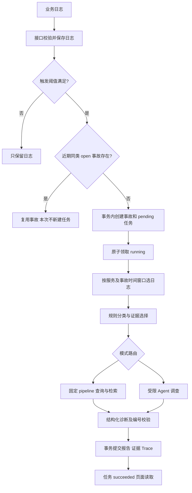

# AI Incident Copilot 项目复习笔记

适用对象：项目已经做过，但大量借助 AI，隔了一段时间后需要重新掌握实现并准备校招面试的开发者。

核对日期：2026-10-15；代码参照 `f054237`。按你简历中的五条经历组织。下面的解释对应当前实现；“回答示例”帮助组织语言，不代表你必须声称所有设计、代码和实验都由自己独立完成。

这份笔记解决“怎么理解、怎么解释”。查具体调用关系用 [项目流程导读](PROJECT_FLOW_GUIDE.md)，练口述用 [自测题](PROJECT_STUDY_QUIZ_20261015.md)，维护状态以 [基线](PROJECT_BASELINE.md) 为准。旧面试稿中引用率、预计算和恢复能力的说法，以本笔记的纠正为准。

## 阅读路线：先建立骨架，再补细节

| 阅读轮次 | 阅读范围 | 读完要做到 |
|---|---|---|
| 第一轮 | 第 1–3 节 | 不看稿讲清系统解决什么问题、一条日志怎样成为报告 |
| 第二轮 | 第 4–8 节 | 能解释简历里检索、Agent 和工程质量的具体实现 |
| 第三轮 | 第 9–12 节 | 解释数字、讲真实缺陷、回答边界和个人贡献 |
| 面试前 | 第 13 节及自测题 | 按问题主动回忆；忘了再回来查 |

不需要一次记住所有配置和文件名。每个模块先回答四件事：输入是什么、做了什么、输出是什么、为什么需要它。文中的案例和伪代码用于教学，除明确注明的验证记录外，不是新跑出的模型答案。

## 1. 先能用自己的话介绍项目

### 1.1 它帮助谁，完成什么工作

假设工程师看到“支付接口返回 500”。真正排查时，需要找同一服务相关日志、判断是数据库还是支付依赖、翻排障手册、找以前的类似故障，最后决定先查哪里。

这个项目把收集和组织这些材料的步骤连起来，生成结构化根因假设和建议。它帮助人缩小排查范围，最终仍需要人到真实系统验证。

**一分钟回答示例：**

> 我做的是面向工程师的日志故障诊断 Copilot。业务日志通过接口接入，达到规则阈值后自动创建事故和分析任务。分析阶段先按服务和时间窗口选日志，做规则分类与证据选择，再检索排障手册和历史案例，交给模型生成结构化根因假设与建议。报告、证据映射和执行记录会保存下来，Dashboard 展示任务与诊断结果。项目也有受限 ReAct 调查分支。我重点处理了检索查询缺失证据词、手册类型误标，以及任务幂等和结果提交一致性，并用模拟故障集做回归和消融评测。

这里的“模型”既可以是真实兼容 API，也可以是用于验证流程的 Mock。面试讲实际效果时，必须说清用了哪一种。

### 1.2 为什么不把全部日志直接发给大模型

日志可能有重复、噪声和无关时间段；模型不知道本项目的排障手册与历史案例；即使回答看起来合理，也可能找不到来源。还有耗时、上下文长度和成本问题。

因此代码分别负责：限定窗口、选证据、找参考资料、限制工具、验证结构、保存结果。模型主要负责根据给定材料组织诊断假设。这个分工比“换个更强模型”更能解释项目的工程内容。

## 2. 八个数据对象：分清它们，流程就不乱

| 对象 | 白话含义 | 关键区别 |
|---|---|---|
| Service | 被观察的业务服务，如 checkout-api | 一个服务有很多日志和事故 |
| LogEntry | 一条日志 | 记录 level、message、事件时间、接收时间 |
| Incident | 一次需要排查的事件 | 表示“发生了什么”，不是一次模型调用 |
| AnalysisJob | 一次分析任务 | 表示排队、运行、成功、失败及进度 |
| AnalysisRun | 一份分析报告 | 同一事故可以先后生成多份报告 |
| IncidentEvidence | 报告与原始日志的关联 | 避免只有模型文字而找不到原日志 |
| AnalysisTrace | 分析步骤的记录 | 说明执行了什么，不证明模型推理正确 |
| DiagnosisFeedback | 人对报告的评价 | 当前只存反馈，没有自动学习通路 |

关系可以记成：

```text
Service ── 多条 LogEntry
   └──── 多个 Incident
              ├── 多个 AnalysisJob ── 成功时关联 AnalysisRun
              └── 多个 AnalysisRun
                         ├── IncidentEvidence ── LogEntry
                         ├── AnalysisTrace
                         └── DiagnosisFeedback
```

“生成报告”“任务成功”“事故已经解决”是三件事。当前每个事故最多一个 pending/running 活动任务，但完成后可以再次创建新任务重新分析。

少量源码入口：[任务模型](../app/models/analysis_job.py)、[报告与证据模型](../app/models/analysis.py)。先看字段和关系，不必读完所有 setter。

## 3. 简历第一条：诊断流程开发

### 3.1 用一次数据库故障走完整条链路

假设新服务在 60 秒内按顺序上报三条 ERROR：

```text
DBConnectionTimeout connecting to postgres
Order failed because database is unavailable
Checkout API returned 500 after database write failure
```



第一步是接入：`POST /logs` 需要已有 service_id；`POST /ingest/logs` 可以按 service_name 自动注册服务。Python logging handler 默认用有界队列和后台线程发日志，避免业务线程等待 HTTP；虽然内部按批取队列，仍是逐条发 `/logs`，不是批量写入 API。

第二步是触发：默认启用自动事故，ERROR/CRITICAL 在同服务 60 秒事件时间窗口内达到 3 条才考虑立案。这是规则和数据库查询，没有调用 LLM。

第三步是去重：默认查 10 分钟内、同服务、同初判类型、open 的事故。已有事故就复用，本次不会因此自动重跑分析。没有才把 Incident 和 Job 一起提交。

第四步是执行：后台通过带条件的数据库更新领取 pending 任务，然后调用统一分析服务。

第五步是分析：默认选事故创建前 5 分钟到事故创建时刻的日志；自动事故还可能被前一事故时间收紧下界。旧事故重分析不会自动改成读取“现在最新五分钟”。规则得到 database_issue、severity 和证据，检索器再找手册与历史案例。

第六步是保存和展示：报告、证据关联与 Trace 一次提交；随后 Job 关联报告并标成功；页面读取新结果。

### 3.2 去重为什么要保存初判类型

旧逻辑依赖 AnalysisRun 的类别判断是否同类。可是事故刚建好时，报告还没生成；这时新一批同类错误到来，就可能再创建一个事故。

现在在创建 Incident 时保存 `inferred_issue_type`，不等待未来报告。按服务的进程内锁串行化“查已有事故 + 创建事故”，防止单进程里并发双建。这个锁不负责跨进程协调。

### 3.3 规则在算什么，LLM 又在算什么

`detect_issue()` 用正则命中信号，累加“模式权重 × 类别基础权重 × 日志级别权重”，再对症状类别做调整。例如明确数据库信号同时伴随 500 时，降低 server_error 的相对得分。

当前报告的 `issue_type`、`severity` 来自规则；模型生成的是诊断摘要、根因假设、影响范围、结构化建议与缺失信息。不要把规则分类匹配率当作 LLM 根因准确率。

证据优先取主要类别的日志，再补其他类别少量日志，正常匹配路径最多 8 条。这样降低噪声，但也会漏证据。规则只有词面加权，没有完整理解否定语义，所以正常内存/缓存警告仍可能误分类。

### 3.4 Dashboard 的“实时”是什么意思

浏览器以 fetch 读取 `/events` 的 SSE，服务端约每秒查库发快照；事故、日志、任务在数据库侧限额 50 条。页面再按选中事故读取报告。

SSE 是服务端通过一个 HTTP 连接持续发事件。当前底层仍是定时查库，不是数据库变更直接推送。另一个 `/analyze/stream` 将分析放到工作线程，能发送真实步骤进度；诊断文本在生成后发送，并非真实逐 token 输出。

快速定位：[API](../app/api/routes.py) → [自动事故服务](../app/services/automatic_incident_service.py) → [任务服务](../app/services/analysis_job_service.py) → [分析编排](../app/services/analysis_service.py)。

**这一节学会的标准：** 能解释为什么三条日志不等于三个事故，为什么 Job 不能直接用 Incident 替代，以及报告完成为什么不等于业务恢复。

## 4. 简历第二条：检索效果优化

### 4.1 RAG 在项目里到底在哪里

RAG 就是先找与当前问题相关的外部资料，再把资料放进模型输入，让模型据此回答。这里资料是 `runbooks/` 排障手册和 `data/historical_incidents.json` 预置案例。没有训练一个新的大模型。

知识准备与在线使用分开：

```text
知识准备：Markdown → 分块 → 标注来源/标题/类型 → 可选文档编码与持久化
在线使用：事故和证据 → 构造查询 → 选候选/排序/融合 → 把材料交给诊断模型
```

默认按 Markdown 标题和段落分块，每块保留 chunk_id、source、title、content、issue_type、chunk_type。类型标注是代码按词频启发式推断，既不是人工给每块打标签，也不是训练分类器。

### 4.2 TF-IDF：为什么简单方法也有用

TF 表示词在当前文本中的频率，IDF 降低“到处都有”的词的权重。项目实现的平滑 IDF 为：

```text
IDF(t) = log((1 + 文档数) / (1 + 含该词的文档数)) + 1
词权重 = 该词出现次数 / 文本总词数 × IDF
```

查询和每个文档形成词权重向量，用余弦相似度排序。错误码、postgres、redis、连接池等特征词常常很有辨识度，所以 TF-IDF 在项目小语料上有效。它便宜、可解释、不依赖模型下载；弱点是难以连接没有相同词面的语义。

当前实现每次 rank 会基于传入候选文档计算 IDF。因此改过滤策略不仅增加候选，也可能改变原有文档之间的相对排序。

### 4.3 原来错在哪里，改了什么

**问题一：检索查询丢了关键证据。** 旧关键词提取偏向大写开头等形式，全小写 provider、refused、unavailable 等词可能丢失。实际查询只剩事故标题和泛化类型，TF-IDF 看不到最有价值的词。

改动是让模板变体包含证据摘录，关键词提取改为分词、过滤停用词、去重；分析服务还对同文案证据去重，避免错误风暴重复文案虚增词权重。

示意：

```text
信息不足的查询：checkout error timeout issue
加入证据的查询：checkout provider timed out connection refused ...
```

**问题二：手册片段类型误标。** 旧版顺序优先：命中较早类别里的一个词，就可能抢走类型。例如 identity provider 里的 provider 会把认证材料误标成 timeout。

现在对 source/title/content 中各类关键词出现次数计分，最高分胜出，平票按类别表顺序。它减少这种误标，仍然是启发式，有重叠词和边界限制。

这些改动的价值在于：先保证正确材料有机会进入候选，再讨论排序。查询缺词或候选被错过滤时，换融合参数无法补回不存在的材料。

### 4.4 多查询和 RRF：用一个例子记住

模板从症状、证据词和问题类型构造多个查询。默认每个变体取 5 个候选，外层按 chunk ID 融合，最终取 3 个片段。

不同查询的原始分数不好直接比较，RRF 按名次累加：

```text
RRF(材料) = Σ 1 / (k + 它在某个列表中的名次)，默认 k=60，名次从 1 开始
列表一：[A, B, C]
列表二：[B, D, A]
A：1/61 + 1/63 ≈ 0.03227
B：1/62 + 1/61 ≈ 0.03252
D：1/62 ≈ 0.01613
```

B 因为两条查询都排得靠前，融合后略高于 A。RRF 不读取文档语义，也不是“置信度”；一份错误材料若在多个查询里靠前，也可能被加强。

项目里有两处 RRF，别混：多查询融合“不同查询的结果”；hybrid 融合“同一查询的稀疏与稠密结果”。两者使用同一种公式，融合对象不同。

### 4.5 消融实验是什么，为什么没有所有增强全开

消融就是控制其他条件，改变一个模块或参数，观察收益和代价。项目比较 hard/soft/off 过滤、每变体候选数、RRF k，以及查询构建等配置。

历史记录显示：hard 在当前集整体更好；off 和 soft 有负收益；top_k 从 5 增至 8 有负收益；k=20/60/150 没有结果差异。于是保留默认 5 和 60。不是靠“RRF 调参”获得全部提升，最大收益来自证据进入查询。

hard 只检索同类型候选，能减少噪声，但可能挡住跨类型资料：database_issue 也可能需要 auth 标注的配置密钥手册。当前没有免费解决所有案例的参数。

真实模型历史实验中，开启 LLM 改写反而把 Top-1 从 88.89% 降到 81.48%，所以默认模板；真实诊断模型与查询改写模型是两个独立选择。

**回答示例：**

> 我先按失败案例定位查询与候选池的问题，而不是直接增加检索后端。发现证据词被查询构建丢掉、部分手册类型被顺序规则误标，修正后再比较过滤策略和融合参数。当前 27 例模拟集上，TF-IDF 配置的 Top-1 达到 88.89%；hard 过滤整体更好，但仍会漏跨类型手册，所以我保留失败清单，没有把局部指标当作泛化结论。

入口：[查询变体](../app/services/query_rewriter.py)、[分块和类型标注](../app/services/runbook_chunker.py)、[检索](../app/services/runbook_retriever.py)、[RRF](../app/services/rrf.py)、[优化实验记录](../eval/reports/optimization_report_2026-09.md)。

## 5. 简历第三条：检索性能优化

### 5.1 四种选项的职责

| 选项 | 做法 | 主要代价/边界 |
|---|---|---|
| TF-IDF | 比较词权重 | 语义改写、同义词桥接较弱 |
| sentence-transformers | 模型把文本编码成向量，再比相似度 | 当前直接 rank 路径每次编码查询和候选文档 |
| hybrid | 稀疏和稠密结果用 RRF 融合 | 增加稠密模型推理成本 |
| ChromaDB | 持久化文档向量并查询 | 需管理索引、模型与语料的一致性 |

这不是四步串行流程。sentence-transformers 是编码模型，ChromaDB 是存储与检索向量的组件；把两者看成互斥模型会讲错。

BiEncoder 把查询和文档分别编码，文档可以提前算。CrossEncoder 把查询与每个候选配成一对共同打分，更贵，适合粗排之后少量精排。项目可选精排发生在每次 `_rank()` 内部，外层再对多查询结果 RRF；不是先外层融合再统一精排。

### 5.2 377ms 到 16ms 省掉了什么

```text
直接 dense rank：每次请求编码 [query, doc1, doc2, ...] → 计算相似度
持久化路径：准备时编码 documents 并存库
             请求时编码 query → 查询已有文档向量
```

减少的是重复文档编码。在线查询仍要编码，也仍有向量查询开销。

历史 22 例单查询报告记录：dense 377.47ms、ChromaDB 16.31ms，两组 Top-1 都为 81.82%。这对应检索阶段对比，不是模型生成报告的耗时；初始化与索引构建不在该计时段。数字是历史本地条件下的结果，没有证明任意硬件和数据规模都有同样收益。

该原始表位于 `runtime/audit/2026-09-09-preopt/rag_ablation_report.md`，目前是本地忽略文件。数值与来源已在 [本轮审查](CAMPUS_READINESS_REVIEW_20261015.md) 留存；公开展示时不要依赖别人机器一定有 runtime 文件。

**面试回答示例：**

> 原来的直接 dense rank 会重复编码候选文档。我用 ChromaDB 保存预计算文档向量，在线只需编码本次查询并检索。在历史 22 例单查询对比中，两组 Top-1 都是 81.82%，平均检索耗时由约 377ms 降至 16ms。这个比较不含初始化和索引构建，也不能当作完整诊断延迟。

### 5.3 文档改了，旧向量怎么办

只比较文档数量不够：改内容但数量不变，旧索引仍会被误用。项目把语料内容、相关元数据、模型名和分块/文档 schema 版本算成签名；签名与数量一致才复用，否则重建。

重建先做 embedding，成功后才替换旧数据，所以编码失败能保住旧索引。但 delete+add 阶段不是原子切换，该阶段中断仍可能暂时为空，下次初始化再重建。不要说“任何重建失败都完全无损”。

入口：[编码与相似度](../app/services/embedding_service.py)、[向量存储和签名](../app/services/vector_store.py)、[索引新鲜度测试](../tests/test_f08_index_freshness.py)。

## 6. 简历第四条之一：受限 ReAct 调查

### 6.1 Pipeline、Planner、Router、Agent 分别是谁

| 名称 | 当前负责什么 |
|---|---|
| Pipeline | 程序安排固定查询、检索、诊断步骤 |
| DiagnosisPlanner | 确定性 Python 逻辑，生成计划及是否需要两类检索的步骤列表 |
| AnalysisModeRouter | 根据显式配置或复杂度启发式选择 pipeline/agent |
| ReActAgent | 让模型在白名单工具中决定下一步，再由 Python 执行 |

ReAct 可以理解成“根据当前观察选动作 → 执行工具 → 得到观察 → 再决定”。这里记录的 thought 是模型输出的文字，不是对内部推理过程的验证。

没有显式配置时请求模式为 auto；需要真实 Agent 客户端才可能走动态调查。auto 用多种问题信号、日志量、标题与日志冲突等条件判断复杂度。显式 `ANALYSIS_MODE=pipeline` 可固定流程；本轮 27 例成绩就是这个模式，不能用来证明 Agent 更准。

### 6.2 模型能调用什么，不能调用什么

模型返回 JSON action/action_input，Python 只执行白名单：搜索日志、规则检测、关键词查日志、时间线、错误趋势、依赖信号、两类检索、生成诊断。

这些工具都在受控范围：搜索日志返回预先选好的服务窗口；关键词查询搜索已收集日志；依赖检查是识别日志中的词。没有登录生产机器、执行 shell、查询真实数据库或自动修复工具。

### 6.3 “受限”具体落在代码哪里

- 默认决策循环最多 5 步，预算结束后还可能生成最终诊断，因此不等于最多 5 次所有类型的模型调用。
- 未知动作记录决策错误；同工具同参数的重复调用被拒绝。
- top_k、limit 等指定数值参数有类型和范围约束；不能说整个 JSON Schema 的所有字段都完整验证了。
- 仅执行成功的工具进入 `successful_tools`；诊断前至少成功执行过 search_logs、detect_signals。
- 预算耗尽而前置条件不足时，返回证据不足；有前置条件则用现有材料生成诊断。

门禁检查的是工具成功状态，不是判断日志里真的有足够事故事实；也没有要求每次必须检索两类资料。

### 6.4 当前已知回退缺口

模型决策异常后会回退固定步骤，但 provider 仍可能标 `react_llm`，没有记录每次决策回退。2026-10-15 注入 5 次决策失败复现了这个问题，尚未修复。

最终生成诊断失败时的 `mock_fallback` 是另一条路径，已有原因记录。面试时把两层分别讲清，不能用“有 fallback”概括所有调用都被追踪。

入口：[模式路由](../app/agent/analysis_mode_router.py)、[Agent 循环](../app/agent/react_agent.py)、[工具定义](../app/agent/tools.py)、[门禁测试](../tests/test_f05_agent_safeguards.py)。

## 7. 简历第四条之二：证据追溯与模型输出

### 7.1 模型收到什么，返回什么

输入包含事故标题、服务、规则类别及严重程度，还有四类分开的材料：

| 编号 | 材料 | 应当怎样理解 |
|---|---|---|
| E1、E2 | 原始证据日志 | 当前事件的观察材料 |
| N1、N2 | 调查笔记 | 工具派生的统计或观察，不能冒充原日志 |
| R1、R2 | 手册片段 | 排查经验，不证明当前事故必然如此 |
| S1、S2 | 预置历史案例 | 类似参考，不等于当前事实 |

输出 schema 包括 diagnosis_summary、root_cause_hypotheses、impact_scope、structured_suggested_actions、missing_information。每个假设含 cause、confidence 和 supporting_evidence。

JSON/Pydantic 检查字段结构和类型，例如 confidence 在 0–1；结构合法不意味着事实正确。confidence 是自报值，不能解释为已经校准的正确概率。

### 7.2 编号校验到底保证到哪一步

假设本次仅提供 E1/E2，模型却引用 E99：护栏会标 `[UNVERIFIED]`，把该假设置信度封顶 0.35，记录警告。无引用编号、空支持证据也降级。

如果模型写“[E1] 管理员删除了数据库”，而 E1 实际只说连接超时，编号存在，当前护栏不会识别语义不符。它只检查 supporting_evidence 里的编号，不是报告所有字段的事实核验系统。

真实客户端只有在日志、笔记、手册和历史案例全部为空时，才不调模型并弃答。有一份手册并不代表已有充分事故事实。

### 7.3 为什么保存证据映射、笔记和缺失信息

E1 是本次输入的第一条证据，不是数据库 log_id=1。假设最终日志 ID 列表为 `[41, 52]`，则 E1→41、E2→52。`final_evidence_log_ids` 保存这个顺序；调查笔记对应 N 编号；手册和历史案例保存了当次检索快照。

否则模型输出虽然写了 E1，重载报告后却不知道它指什么。missing_information 必须一起落库，否则页面回看时会丢掉模型声明的不确定信息。

**回答示例：**

> 我把原始日志、调查笔记、手册和历史案例分型编号，保存编号到原日志的映射及检索快照。输出后检查支持证据里的引用编号，对无效引用和空引用标记降级。这个机制让来源可以回查，但没有实现语义事实核验，所以最终仍是供人验证的根因假设。

入口：[真实诊断客户端](../app/llm/openai_compatible_client.py)、[输出契约](../app/llm/base.py)、[引用护栏](../app/llm/citation_guard.py)、[持久化验证](../tests/test_r03_output_persistence.py)。

## 8. 简历第五条之一：工程一致性

### 8.1 原子领取、唯一索引、结果事务解决三种不同问题

| 机制 | 防止什么 | 不负责什么 |
|---|---|---|
| 原子领取同一 Job | 两个执行者都处理同一个 pending 任务 | 不负责阻止创建两个不同 Job |
| 每事故活动任务部分唯一索引 | 同一事故同时存在两个 pending/running 任务 | 不禁止完成后重新分析 |
| 报告、证据、Trace 一次事务提交 | 只保存半份分析结果 | 不把所有 Job 状态更新也合成同一事务 |

领取示意 SQL：

```sql
UPDATE analysis_jobs
SET status = 'running', started_at = :now
WHERE id = :job_id AND status = 'pending';
```

关键是更新条件和受影响行数。一个执行者把 pending 改走，另一个再更新时命中 0 行，就不执行。不是先 SELECT 看见 pending 再无条件 UPDATE，也不是依靠 Python if 就能防并发。

活动任务索引只对 status IN ('pending','running') 生效；接口撞唯一约束后回滚，并在允许复用的入口读取已有任务。不能给 incident_id 普通全表唯一约束，否则永远不能重新分析。

### 8.2 一个很值得讲的真实缺陷：进度 commit 提前提交报告

原来分析服务新增 AnalysisRun 并 flush 后，马上通知 persistence 进度。进度回调与分析共用 Session，并调用 commit，意外把还没写完证据/Trace 的报告提交了。后续 Trace 异常时 rollback，也撤不回已提交的半成品。

修复是把 persistence 进度挪到报告、证据、Trace 整体 commit 之后；写报告过程不再触发可能提交的回调。

```text
错误顺序：flush 报告 → 进度回调 commit → 写 Trace 失败 → 半份报告残留
当前顺序：flush 报告 → 写证据/Trace → 整体 commit → 汇报已持久化
```

flush 把变更发给数据库，通常能拿到自增 ID；commit 才结束并提交事务。flush 后还可回滚，commit 后不能靠这次 rollback 撤销。

测试用文件数据库和第二连接观察提交前后，又注入 Trace 写入异常检查是否留下半成品。它验证业务后果，不是只测“调用了 commit”。

边界也要知道：报告提交与 Job 最终成功关联是两步；后者失败时可能留下完整报告但任务失败。当前保证的是报告内部不残缺，不是报告和全部任务状态严格一次提交。

### 8.3 启动时恢复是什么语义

```text
pending → 启动后重新派发
running → 标失败，说明进程中断
succeeded → 重入不再运行
```

没有从模型调用中断点续跑，也没有自动重试所有失败任务。单进程下能识别遗留 running，多 worker 下别的进程可能还在执行，不能直接这样清场。要扩展时才需要讨论心跳、租约、独立 worker 和可靠队列。

### 8.4 再掌握两个支撑细节

时间：带时区输入统一转 UTC，无时区按 UTC 解释；事件时间 timestamp 与服务接收时间 received_at 分开。判断窗口补上下界，避免未来日志替历史日志凑阈值；极端倒序投递仍有限制。

配置：`.env` 必须在数据库 engine、导入时读取的开关初始化前加载。否则环境变量表面变了，已创建 engine 仍连旧库。现有 `app.main` 先 prepare_config 再导入这些模块。

入口：[领取与恢复](../app/services/analysis_job_service.py)、[事务故障注入测试](../tests/test_analysis_transaction.py)、[并发领取测试](../tests/test_f02_job_idempotency.py)、[初始化入口](../app/main.py)。

## 9. 简历第五条之二：测试、Eval、Judge

### 9.1 三种验证，回答三种问题

| 验证 | 它在问什么 | 不能由此证明什么 |
|---|---|---|
| Pytest 自动化测试 | 幂等、事务、门禁、接口、迁移等是否符合约定 | 真实模型一定诊断正确 |
| 27 例离线 Eval | 类别、证据关键词、手册来源等是否匹配预期标签 | 所有线上接入路径和生产泛化 |
| LLM-as-Judge | 模型评价报告连贯性、依据、建议和幻觉标记 | 人工根因真值、客观正确引用比例 |

2026-10-15 本会话前轮执行得到 235 passed / 5 warnings；本次写笔记没有再次运行业务测试。235 是通过的测试项数量，不是覆盖率，也不等于测试了 235 种真实故障。

### 9.2 四个指标，亲手算一次

假设期望手册来源为 `{A.md, B.md}`，取回 3 个片段来源 `[A.md, C.md, A.md]`：

- Top-1：首条 A 在期望集合中，因此本例为 1。
- Recall：期望的两份来源只命中 A，所以为 1/2。
- 项目 P@3：三个位置中有两个来自期望来源，计为 2/3。这里按返回片段位置计分，没有按来源去重。
- 证据关键词召回：若预期词为 postgres、refused，只在最终证据里找到 postgres，则为 1/2。这是关键词覆盖，不是语义证据充分度。

跨案例 Recall 是每例先计算再取平均，并非把所有来源合并算一个总比率。期望手册为空时，当前实现要求实际也为空才给满分；Top-1 的空期望也有同类约定，所以 27 例总体数字包含这种案例。

`passed` 需要类别、严重程度、证据关键词及两类来源召回同时满足条件；Judge 分数不参与这个通过判定。因此 9 例失败并不等于 9 例“模型根因错误”。

### 9.3 把简历上的数字分到各自实验里

| 数字 | 正确解释 | 证据 |
|---|---|---|
| 55.56%→88.89% | 27 例模拟集的 TF-IDF 配置 Runbook Top-1；前值历史，后值本轮已复现 | 优化报告、本轮评测 |
| 77.16%→84.57% | 同组 Runbook 来源 Recall，不是所有正确证据的召回 | 同上 |
| 377.47ms→16.31ms；81.82% | 历史 22 例单查询 dense 与 ChromaDB 检索对比；两组 Top-1 相同 | 本地历史消融表 |
| 235 passed | 当前版本自动化测试通过项数 | 本会话前轮 pytest |
| 87.59% | 历史 Judge grounding 平均评分 | 不作为引用正确率宣传 |

27 例分析服务评测与 22 例检索消融不是同一实验。消融脚本给检索传入 expected_issue_type、使用案例日志构造查询，旨在隔离检索能力；正式分析先跑规则再取证。样本范围、输入和流程都不同，不要把各表最好值拼成同一配置的成绩。

### 9.4 为什么“开卷 Judge”是一个真实修复

诊断模型拿到了手册和历史案例，裁判却只看到日志。模型引用了历史资料中真实存在的案例名，裁判因为看不见这些资料而判编造，相当于用不完整试卷判答案。

修复是把检索手册和历史案例也传给裁判，明确允许以参考材料为依据。另一个已修问题是评测对已经是 dict 的假设调用 model_dump，调用前就失败又被吞掉；现在报告显式记录 attempted/succeeded/failed 与脱敏错误。

这是修正测量方法。历史“幻觉标记由 92.59% 变成 0”不能解释成模型真实幻觉减少这么多；同模型裁判、小样本、有限人工标签仍会影响结论。Agent 的调查笔记与编号上下文也没有在 `_run_judge` 中完整复刻，不应声称所有模式下裁判输入与诊断输入完全相同。

入口：[评分公式和入口](../eval/run_eval.py)、[Judge](../app/services/llm_judge.py)、[Judge 异常测试](../tests/test_eval_judge.py)。

## 10. 三个面试案例：每个都能讲出机制和边界

### 成功案例：数据库连接故障

讲第 3 节的三条 ERROR：触发阈值、创建事故与任务、规则分类、检索、报告、证据回查。2026-10-15 隔离应用接口冒烟实际跑到一个 succeeded 任务、database_issue、3 条证据与 3 个手册块；当时是 Mock，不能说验证了真实模型根因正确性。

### 失败案例：配置密钥与跨类型手册

数据库连接故障可能源于配置密钥错误，但需要的配置手册被标成 auth；hard 类型过滤只留 database 候选。即使数据库类别判断正确，也不代表正确手册能被召回。soft/off 整体有负收益，因此当前保留 hard 并记录限制。

用“失败现象 → 候选池里有没有目标 → 排名位置 → 过滤/融合的代价”定位，不要一句话归因于大模型不好。

### 降级案例：真实模型不可用

最终诊断请求失败可回到 mock_fallback，记录请求后端与失败原因；Job 仍可能成功，因为流程完成并保存了模板报告。要从实际 provider 判断是否真模型生成，不能只看 Job succeeded。Agent 决策回退的记录缺口另外说明。

一个更适合讲个人排障经历的案例是第 8 节的进度 commit 缺陷：触发条件、错误根因、修改位置、故障注入测试都很具体。

## 11. 个人贡献：怎样把 AI 辅助开发变成自己的理解

不要把“仓库里有”直接换成“全部独立设计并实现”。先给简历五条逐一标记：自己提出需求的、自己做过取舍的、AI 起草但自己理解并验证的、目前还讲不清的。

回答“用了多少 AI”可以据实组织为：

> 项目开发使用了 AI 辅助，部分模块和测试由 AI 起草。我负责的工作包括……，其中我能完整说明的是……。我会通过读关键实现、运行测试、检查评测与失败案例来验证输出；对还没独立掌握的部分，我不会把它说成自己从零独立完成。

省略号必须换成真实经历，不要照抄虚构参与。面试前尽量亲手完成一件小事：解释一个现有测试，改一个副本里的参数并预判结果，或者追踪一次异常。重点是能预测行为，而不是背文件名。

## 12. 不必通读代码：只定位这些函数

| 优先级 | 文件与函数 | 看代码时只解决一个问题 |
|---|---|---|
| 必看 | analysis_service.analyze_incident | 公共准备、两条分支和保存怎样连接 |
| 必看 | analysis_service._run_pipeline | 查询、逐变体检索与 RRF 顺序 |
| 必看 | query_rewriter._template_rewrite / _extract_keywords | 证据词怎样进入查询 |
| 必看 | runbook_chunker.infer_issue_type | 误标为什么发生，如何计分 |
| 必看 | analysis_job_service._try_claim | 并发时为什么只有一个执行者 |
| 必看 | citation_guard.verify_and_downgrade | 护栏看得到什么、看不到什么 |
| 必看 | run_eval._score_case / _source_recall | 数字到底算的是什么 |
| 第二遍 | ReActAgent.investigate / _llm_decide | 门禁、预算和静默回退 |
| 第二遍 | SentenceTransformerEmbedder.rank / VectorStore.query_runbooks | 为什么持久化能减少重复编码 |
| 第二遍 | test_analysis_transaction | 如何用第二连接和异常注入验证原子性 |

源码导航：[分析](../app/services/analysis_service.py) · [查询](../app/services/query_rewriter.py) · [分块](../app/services/runbook_chunker.py) · [任务](../app/services/analysis_job_service.py) · [护栏](../app/llm/citation_guard.py) · [评测](../eval/run_eval.py) · [Agent](../app/agent/react_agent.py) · [编码](../app/services/embedding_service.py) · [向量存储](../app/services/vector_store.py) · [事务测试](../tests/test_analysis_transaction.py)。按函数名定位比记行号稳定。

## 13. 面试前复习安排与一页速记

### 四次学习，每次有明确产出

1. 阅读第 1–3 节，画出 Service/Incident/Job/Run 的关系，口述一次数据库故障流程。不会的步骤回看对应节。
2. 阅读第 4–5 节，手算一个 RRF，分别解释 TF-IDF、dense、ChromaDB；写清两组实验为何不能混用。
3. 阅读第 6–9 节，用自己的话讲门禁、引用边界、原子领取和原子提交；挑一个现有测试读懂断言。
4. 合上资料完成自测，录一段 2–3 分钟项目介绍。听回放，把“做了优化、提升可靠性”之类空话替换成具体机制。

### 一页速记

- 目标：日志与知识资料组织成根因假设及建议，工程师验证。
- 数据：Incident 是事件，Job 是执行，Run 是报告；反馈不等于自动学习。
- 触发：默认同服务 60 秒 3 条 ERROR/CRITICAL；近期 10 分钟同类 open 事故去重。
- 分析：事故时间窗口 → 规则与证据 → pipeline/agent → 检索 → 诊断 → 原子保存。
- 检索优化：证据词进查询、类型计分修误标；hard 的噪声收益与跨类型召回代价。
- RRF：累加 1/(k+rank)，k=60；融合名次，不是平均置信度。
- 性能：缓存/持久化文档向量，查询仍编码；历史检索计时不等于全流程。
- Agent：白名单、指定参数约束、重复拒绝、工具成功门禁、有限决策预算；决策回退记录仍有缺口。
- 证据：E/N/R/S 分型；编号有效不等于语义支持；confidence 非校准概率。
- 工程：条件更新防同任务双执行；部分唯一索引防双活动任务；事务防半份报告。
- 恢复：pending 重派、running 标失败；仅单进程，不是断点续跑。
- 指标：88.89% 是 Runbook Top-1；84.57% 是来源 Recall；235 是通过测试项数。
- 评测：合成回归集、无独立泛化证明；Judge 开卷修误判，评分不是事实真值。

## 编写与核对说明

本次复用已有流程文档和审查记录，重新核对查询构建、分块类型、TF-IDF/dense、RRF、索引签名、Planner、模型/证据契约、任务约束、评分公式及关键测试。本次只新增学习资料并更新入口，不改业务代码、不调用真实模型、不启动服务、不操作运行库，也没有重跑历史性能实验。验证采用链接检查、代码符号定位、数字公式检查和已有记录对照。
